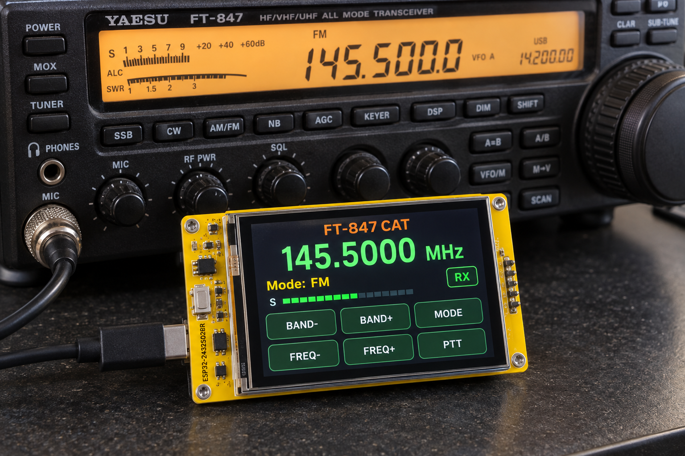
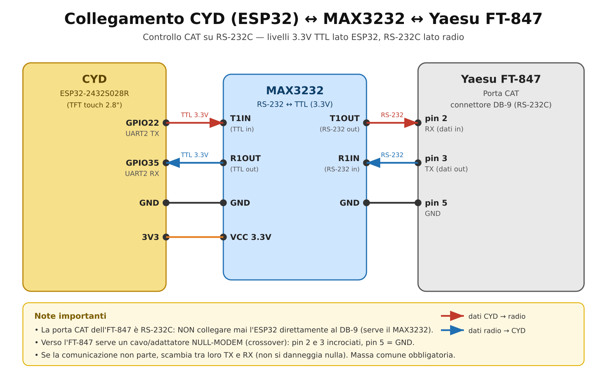

# FT-847 CYD Controller

Controllo di una radio **Yaesu FT-847** via **CAT** tramite un ESP32 **"Cheap Yellow Display"** (CYD, modello `ESP32-2432S028R`) e il suo display TFT touch da 2,8".

Progetto pronto per **VS Code + PlatformIO**: basta aprire la cartella, collegare la scheda e premere *Upload*. La configurazione del display è già inclusa in `platformio.ini`, quindi **non serve modificare nessun file della libreria TFT_eSPI**.



---

## Caratteristiche

- Interfaccia touch con display grande della frequenza (risoluzione 10 Hz).
- Sei pulsanti: `BAND-`, `BAND+`, `MODE`, `FREQ-`, `FREQ+`, `PTT`.
- Indicatore **RX/TX**, **modo** corrente e **S-meter** (letto dalla radio).
- Menu seriale di test via USB (utile senza touch): `F`, `M`, `T`, `R`, `S`, `Q`, `C`.
- Protocollo CAT dell'FT-847 implementato correttamente (blocchi da 5 byte, opcode in **ultima** posizione, frequenza in BCD big-endian di `Hz/10`).
- Codice modulare: `config.h` (hardware), `cat_ft847.*` (protocollo), `main.cpp` (GUI + logica).

---

## Hardware necessario

| Componente | Note |
|---|---|
| ESP32-2432S028R (**CYD**) | ESP32-WROOM-32 + TFT 2,8" 240×320 + touch resistivo XPT2046 |
| **MAX3232** (modulo o breakout) | Adattatore di livello **RS-232C ↔ TTL 3,3 V**. Usare il **MAX3232** (3,3 V), *non* il MAX232 (5 V). |
| Cavo **NULL-MODEM** (crossover) | DB9-F/DB9-F con pin 2↔3 scambiati, pin 5 = GND |
| Alimentazione 5 V USB | Per la CYD |

> La porta CAT dell'FT-847 è una **RS-232C** su connettore **DB-9**. La radio ha già al suo interno il convertitore di livello, quindi serve solo un adattatore di livello verso il TTL 3,3 V dell'ESP32 (il MAX3232) e un cavo **null-modem**.

---

## Schema di collegamento



### Collegamenti

| CYD (ESP32) | MAX3232 | FT-847 (DB-9) |
|---|---|---|
| GPIO22 (UART2 TX) | T1IN | — |
| GPIO35 (UART2 RX) | R1OUT | — |
| GND | GND | Pin 5 (GND) |
| — | T1OUT | Pin 2 (RX radio) |
| — | R1IN | Pin 3 (TX radio) |

Se la comunicazione non parte, **scambiare TX ↔ RX** (pin 2 e 3).

### Pin del CYD utilizzati

| Funzione | GPIO |
|---|---|
| TFT (SPI display, HSPI) | MISO 12, MOSI 13, SCLK 14, CS 15, DC 2, RST −1, BL 21 |
| Touch XPT2046 (SPI separato, VSPI) | IRQ 36, MOSI 32, MISO 39, CLK 25, CS 33 |
| CAT UART2 | TX 22, RX 35 |

> ⚠️ Sulla CYD il **touch è su un bus SPI diverso** da quello del display: per questo si usa la libreria `XPT2046_Touchscreen` con un'istanza `SPIClass(VSPI)` separata, mentre il display usa `USE_HSPI_PORT`. Le funzioni touch integrate di TFT_eSPI **non** funzionano su questa scheda.

---

## Requisiti software

- [VS Code](https://code.visualstudio.com/) con l'estensione **PlatformIO IDE**.
- Driver USB-seriali (CP210x o CH34x a seconda del modulo).
- Le librerie vengono scaricate automaticamente da `platformio.ini`:
  - `bodmer/TFT_eSPI`
  - `https://github.com/PaulStoffregen/XPT2046_Touchscreen.git`

---

## Compilazione e caricamento

1. Apri VS Code → **File ▸ Apri cartella…** e seleziona la cartella `ft847-cyd-controller`.
2. Attendi che PlatformIO installi la piattaforma e le librerie (prima volta: qualche minuto).
3. Collega la CYD via USB.
4. Premi **Upload** (icona →) oppure, da terminale:

```bash
pio run -t upload
pio device monitor        # monitor seriale a 115200 baud
```

---

## Impostazioni della radio

1. Menu **#37 [CAT RATE]** = **4800** (oppure 9600/57600, ma deve combaciare con `CAT_BAUD` in `include/config.h`).
2. Formato seriale fisso dell'FT-847: **8 data bit, no parità, 2 stop bit (8N2)** — già impostato nel codice.
3. Alcuni esemplari **molto precoci** di FT-847 non supportano la *lettura* dello stato: in quel caso l'S-meter resta a zero, ma i comandi di frequenza/modo/PTT funzionano comunque.

---

## Uso

### Pulsanti a schermo

| Pulsante | Azione |
|---|---|
| `BAND-` / `BAND+` | Seleziona la banda precedente/successiva (frequenze tipiche) |
| `FREQ-` / `FREQ+` | Sintonia fine ±1 kHz |
| `MODE` | Cicla LSB → USB → CW → AM → FM |
| `PTT` | Attiva/disattiva la trasmissione (PTT via CAT) |

### Comandi seriali (USB, 115200 baud)

| Comando | Descrizione |
|---|---|
| `F<hz>` | Imposta frequenza in Hz (es. `F145500000`) |
| `M<modo>` | Imposta modo (valore esadecimale, es. `M1` = USB) |
| `T` / `R` | PTT ON / PTT OFF |
| `S` | Legge lo stato RX (S-meter) |
| `Q` | Legge frequenza + modo dalla radio |
| `C` | Attiva/disattiva la stampa dei valori grezzi del touch (calibrazione) |

---

## Calibrazione del touch

Il touch resistivo può richiedere una regolazione. In `include/config.h`:

```c
#define TOUCH_X_MIN   200
#define TOUCH_X_MAX   3700
#define TOUCH_Y_MIN   240
#define TOUCH_Y_MAX   3800
```

Per calibrare:

1. Invia il comando seriale `C` (attiva l'output grezzo).
2. Tocca gli angoli dello schermo e leggi i valori `raw x=… y=…` sul monitor seriale.
3. Aggiorna i quattro valori `TOUCH_*` con i minimi/massimi osservati.
4. Se il touch è **specchiato**, cambia `touchscreen.setRotation(1)` in `setRotation(3)` in `src/main.cpp`.

---

## Protocollo CAT dell'FT-847 (riferimento rapido)

I comandi sono **blocchi da 5 byte**: 4 byte di dati + 1 byte di **opcode in ultima posizione**.

| Funzione | Byte (D1 D2 D3 D4) | Opcode |
|---|---|---|
| Imposta freq MAIN | BCD big-endian di `Hz/10` | `0x01` |
| Imposta freq SAT RX / TX | idem | `0x11` / `0x21` |
| Imposta modo MAIN | modo, 0, 0, 0 | `0x07` |
| PTT ON / OFF | 0,0,0,0 | `0x08` / `0x88` |
| CAT ON / OFF | 0,0,0,0 | `0x00` / `0x80` |
| Leggi freq+modo MAIN | 0,0,0,0 | `0x03` |
| Leggi stato RX / TX | 0,0,0,0 | `0xE7` / `0xF7` |

**Codici modo (D1):** LSB `0x00`, USB `0x01`, CW `0x02`, CW-R `0x03`, AM `0x04`, FM `0x08`; versioni narrow: CW-N `0x82`, CW-R-N `0x83`, AM-N `0x84`, FM-N `0x88`.

**Stato RX (`0xE7`):** bit 0-4 = S-meter (0-31), bit 5 = discriminatore, bit 6 = CTCSS, bit 7 = squelch.

> Nota: l'FT-847 usa l'opcode in **ultima** posizione, a differenza della famiglia FT-817/857/897 dove è in prima posizione.

---

## Struttura del progetto

```
ft847-cyd-controller/
├── platformio.ini          # configurazione PlatformIO + TFT_eSPI (build_flags)
├── src/
│   ├── main.cpp            # GUI, setup/loop, menu seriale
│   └── cat_ft847.cpp       # implementazione protocollo CAT
├── include/
│   ├── config.h            # pin, baud, calibrazione touch
│   └── cat_ft847.h         # definizioni e API del protocollo CAT
├── docs/
│   ├── schema_collegamento.png / .svg
│   ├── gui_mockup.png
│   └── FT847_CYD_guida.pdf / .md   # guida tecnica completa
├── lib/                    # (vuoto) librerie private
├── LICENSE                 # MIT
└── README.md
```

---

## Risoluzione dei problemi

| Sintomo | Possibile causa / rimedio |
|---|---|
| Il display resta nero | Verifica il driver: la CYD usa `ILI9341_2_DRIVER`. Alcune revisioni montano ST7789 → cambia il driver in `platformio.ini`. |
| Il touch non risponde | Assicurati di usare `XPT2046_Touchscreen` su VSPI (non il touch di TFT_eSPI). Ricalibra con il comando `C`. |
| La radio non risponde | Scambia TX↔RX; verifica il cavo null-modem; controlla il baud (Menu #37) e i livelli RS-232 (MAX3232). |
| L'S-meter resta a zero | Esemplare precoce senza lettura, oppure cavo/baud errati. |
| Colori invertiti | Aggiungi `-DTFT_INVERSION_ON=1` nei `build_flags`. |

---

## Crediti e riferimenti

- Manuale d'uso Yaesu **FT-847** e *CAT Command Chart*.
- [Hamlib](https://github.com/Hamlib/Hamlib) (`rigs/yaesu/ft847.c`) per la conferma del formato BCD big-endian.
- [Bodmer/TFT_eSPI](https://github.com/Bodmer/TFT_eSPI) — display.
- [PaulStoffregen/XPT2046_Touchscreen](https://github.com/PaulStoffregen/XPT2046_Touchscreen) — touch.
- [Random Nerd Tutorials](https://randomnerdtutorials.com/cheap-yellow-display-esp32-2432s028r/) — pinout e configurazione CYD.

---

## Licenza

Rilasciato sotto licenza **MIT** — vedi il file [LICENSE](LICENSE).
